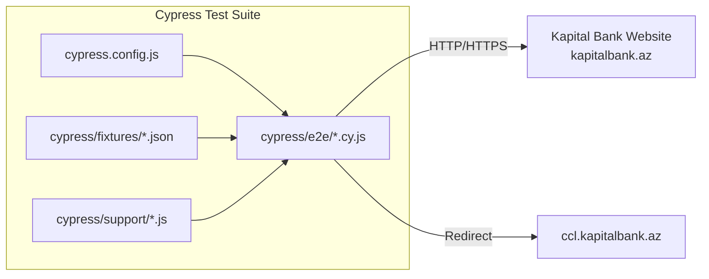

# Architecture — QA-KB-task

## Module diagram



## Data models

No application data models — this is a test-automation repo. Test data lives in `cypress/fixtures/kb_order.json`:

```json
{
  "title": "Kapital Bank",
  "mobileNumber": "511111111",
  "FIN": "123XH45",
  "OTP": "1234",
  "en": {
    "main_page": {
      "card_count": 4,
      "card_list": [
        {
          "BRCB_BLACK": {
            "cards_section__top": {
              "container": {
                "h1_text": " Birbank Cashback installment ",
                "p": " It is a unique card providing cashless payments with installment starting from 1.5% cashback, interest-free and commission-free. "
              }
            },
            "cards_section__bottom": {
              "li": { "li_count": 3, "li_text": [...] },
              "img": "birbank-cashback-home",
              "a_herf": "https://ccl.kapitalbank.az/en/order/step/BRCB_BLACK?t=kb&tvr_id=",
              "a_text": "Order"
            }
          }
        }
      ]
    }
  }
}
```

All values are synthetic placeholders — no real user data.

## API contracts

No API of its own. Test interacts with:
- `GET https://www.kapitalbank.az/en` (home page)
- `GET https://ccl.kapitalbank.az/en/order/step/BRCB_BLACK?t=kb&tvr_id=` (order redirect)

## Authentication

None — tests run against public website without authentication.

## Database

None — no database, no migrations, no seeders.

## Configuration

| File | Purpose |
|---|---|
| `cypress.config.js` | `baseUrl`, `chromeWebSecurity: false`, empty `setupNodeEvents` |
| `package.json` | `name`, `devDependencies` (cypress), placeholder `test` script |
| `package-lock.json` | Locked dependency tree |

## Testing

| Layer | Tool | Specs | Coverage |
|---|---|---|---|
| E2E | Cypress | 2 (`KB_mainPage_OrderCard.cy.js`, `test.cy.js`) | Home page carousel + order button; fixture round-trip |
| Unit | None | — | — |
| Integration | None | — | — |

Run locally: `npx cypress open` (interactive) or `npx cypress run` (headless). No `npm test` script.

## Security

- No secrets in repo (fixtures synthetic: `OTP: "1234"`, `mobileNumber: "511111111"`, `FIN: "123XH45"`)
- `chromeWebSecurity: false` weakens browser same-origin policy — required only for off-site redirect to `ccl.kapitalbank.az`; test-only, not production
- No CI → no secret scanning in pipeline
- 11 npm vulnerabilities (per README) — all transitive in `cypress@13.5.1` deps; not this repo's code